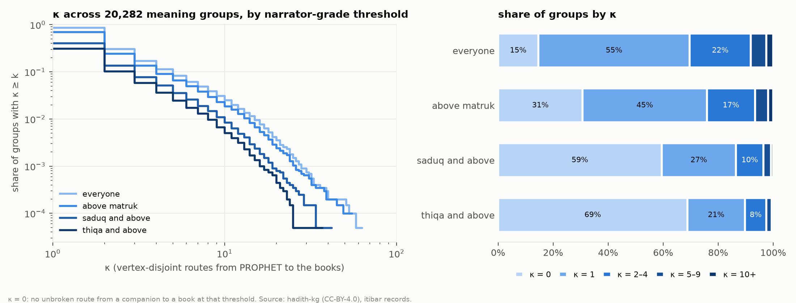

# itibar

**The transmission network behind the hadith, computed.**

A hadith is a report of something the Prophet Muhammad said or did. Each one comes with its
*isnad*: the chain of people who passed it down, from the Prophet's companions to the scholars
who wrote it into the hadith collections. Most reports survive through many chains. Classical
hadith critics judged a report partly by gathering all of its chains side by side, a step they
called *i'tibar*, to see whether it reached the books through many independent lines or hung on
a single person. They did this by hand, one report at a time.

itibar does it for the whole corpus: 715,790 narrations with 577,024 recorded chains through
49,844 narrators. For each of the 20,745 reports it merges every chain into one graph and measures it:

- **Independent routes (κ).** How many lines of transmission share no narrator at all, computed
  exactly as a minimum vertex cut (Menger's theorem). It is recomputed at each level of the
  classical narrator ratings, from everyone down to only those rated trustworthy.
- **Bottlenecks.** The narrators that every route passes through.
- **Common links.** The narrator at which a report first fans out to many students.
- **A derived grade with a receipt.** The grade the classical narrator ratings imply, with every
  step written out.

The machinery issues no verdicts of its own and uses no machine learning. Every number traces to
the source data. The whole corpus runs in about 25 seconds on a laptop, deterministically, from
open data.

### Checked against the classical scholars

The textbook example, used as such by Ibn al-Salah, is *"Actions are only by intentions"*
(إنما الأعمال بالنيات). Ibn Hajar records that, through 'Umar, it passed through exactly one person
per generation for four generations, 'Umar → 'Alqama → Muhammad b. Ibrahim al-Taymi → Yahya b. Sa'id al-Ansari
(d. 143 AH), and only then spread to many students. On its chains through 'Umar, itibar finds
those same four narrators as the bottleneck on every route (κ = 1), with at least 25 students
below Yahya. The 14 chains in the data that break the pattern are each listed with the reason.

The gold set holds 22 cases like this from the classical literature: narrow reports that classical
works trace through specific narrators, and *mutawatir* reports carried by ten or more
companions. The test suite asserts every one, the narrow cases down to the exact narrators.

### What it finds

Of the 20,282 reports with chains, 55% pass through a single person somewhere on every route
(κ = 1). 505 have ten or more fully independent routes; keeping only narrators rated *thiqa*
(trustworthy), 102 still do. Full results are [below](#results-at-a-glance-full-corpus).

**Next:** corroboration (how independent supporting routes strengthen a report) and aligning each
report's text variants against its chains. The end products are an open dataset, a paper, and a
queryable site.

## Technical summary

Corpus-scale isnad-bundle analysis. For every report (meaning group) in a 715,790-hadith corpus,
itibar overlays every chain into one graph from the Prophet to the books — the *isnad bundle* —
and computes its structure (width by generation, vertex connectivity at narrator-grade
thresholds, cut vertices, single strands, partial and common links, continuity), a mechanically
derived grade with a receipt — the best single chain (v1) and the classical ladder with
corroboration under two rulesets (v2) — the classical number class, Ibn Hajar's indicators
(qarāʾin), and corpus-wide checks of the classical mutawātir lists, the common links and the
chapters of the law. The name is the classical term for this operation: gathering all the chains
of a report to see what corroborates what.

**Design rule.** The machinery computes structure and derives grades mechanically from the
classical narrator verdicts, with a receipt for every number. It never issues a verdict of its
own, uses no ML, and its own outputs never use verdict words. Source labels (صحيح, ضعيف …) are
quoted in Arabic as the source's. Where the tradition has two readings, both are implemented as
selectable rulesets and both are reported. Knowledge yield (certainty vs probability) is not
computed: the qarāʾin are reported as flags and the conclusion is left to the reader.

The build briefs are [docs/prompts/bucket-1.md](docs/prompts/bucket-1.md), its corrections in
[docs/prompts/pr-2.md](docs/prompts/pr-2.md), and [docs/prompts/bucket-2.md](docs/prompts/bucket-2.md);
records carry `structure_version` (now 3) and `derive_version` (now 2), both in
`config/structure.yaml`. Every choice the data or the sources forced that the briefs did not settle
is in [DECISIONS.md](DECISIONS.md); the source audit is [reports/audit.md](reports/audit.md);
gold-set results are [reports/gold.md](reports/gold.md); the bucket-2 reports are
[reports/lists.md](reports/lists.md), [reports/common_links.md](reports/common_links.md),
[reports/chapters.md](reports/chapters.md) and [reports/pools/](reports/pools/).

## Reproduce from scratch

Requires [uv](https://docs.astral.sh/uv/) (Python 3.12 is fetched by uv) and Graphviz (`dot`) for rendering.

```bash
make data      # download hadith-kg.db (pinned revision, sha256-checked) -> data/; Parquet + DuckDB -> data/parquet/
make audit     # reports/audit.md; regenerates the label listing in config/grades.yaml
make bundles   # out/words.parquet, out/bundles/, out/records.parquet, out/chains.parquet  (~45 s on an M-series laptop)
make narrators # out/narrators.parquet, reports/common_links.md, figures/fig4_cl_death_years.*
make lists     # lists/*.yaml from lists/source/, lists/candidates.csv, lists/confirmed.csv, reports/lists.md, fig3
make chapters  # reports/chapters.md, figures/fig5_chapter_census.*
make pools     # reports/pools/mahdi.*, reports/pools/dajjal.* (the two topic-subtree case studies)
make gold      # reports/gold.md + gold tests
make test      # unit tests, gold set, corpus gates
make figures   # figures/fig1_kappa.*, figures/fig2_width_by_tabaka.* (+ CSV of every plotted number)
uv run itibar show 319     # a record as a readable card (Arabic text, names, numbers, receipts v1 and v2)
uv run itibar render 319   # figures/bundles/group_319.svg
uv run itibar pool --topic 28661          # pooled bundle: --groups g1 g2 …, --topic <topics.id>, --entry kattani:2
```

`make ci` runs the whole pipeline and test suite on the committed fixture
(`tests/fixture/parquet`, 338 groups with the topic nodes above them, 6.9 MB; regenerate with
`make fixture`) — what GitHub Actions runs, with no download. `make lists-fetch` re-downloads the
al-Kattānī text from Shamela's public read-only MCP server (`https://mcp.shamela.ws`); its output,
`lists/source/kattani_7016.jsonl`, is committed so `make lists` needs no network. On the fixture's groups the records are identical to the full run.
Outputs are deterministic (identical across processes and hash seeds).

The source database is read-only input: opened `mode=ro&immutable=1`, never modified, never
committed. Revision and digest are pinned in `config/source.yaml`.

## Data and provenance

Input: [emadjumaah/hadith-kg](https://huggingface.co/datasets/emadjumaah/hadith-kg), file
`hadith-kg.db` (CC-BY-4.0), built by [emadjumaah/hadith](https://github.com/emadjumaah/hadith)
(`build_hkg.py`, `clean_hkg.py`, `finalize_hkg.py`, `DATA_REPORT.md`). **Known limitation:** the
upstream build reads a 2017 MongoDB dump of an Arabic hadith project it does not name, plus a
meaning-groups CSV; narrator resolution, meaning grouping, the narrator grades and the recorded
hadith grades are that project's, not ours. itibar redistributes only its derived outputs
(`out/`, `figures/`, `reports/`), under CC-BY-4.0 with attribution to hadith-kg
([DATA_LICENSE.md](DATA_LICENSE.md)). Code is MIT.

Tables converted (`data/parquet/`): meta, books, rawis, alems, aqwal, meaning_groups, tarafs,
hadiths, hadith_rawis, hadith_ayas, sanads, sanad_rawis, topics; plus the derived
`book_compilers`. Not converted: `group_embedding` (ML vectors) and `sqlite_stat1`.
`data/parquet/hkg.duckdb` holds a view per table for ad-hoc SQL.

## Definitions

All parameters live in `config/` (`grades.yaml`, `structure.yaml`, `source.yaml`).

### Narrator grade ordinal — `config/grades.yaml`
`rawis.rank_no` is Ibn Hajar's twelve-level scale from *Taqrib al-Tahdhib* (verified in the
audit): 1 companions, 2 `ثقة ثقة`/`حافظ`, 3 `ثقة`, 4 `صدوق`, 5 `صدوق يهم`…, 6 `مقبول`, 7 `مجهول الحال`,
8 `ضعيف`, 9 `مجهول`, 10 `متروك`, 11 `متهم بالكذب`, 12 `كذاب`/`وضاع`. Higher is weaker.

    ordinal(narrator) = 13 − rank_no        (1 ≤ rank_no ≤ 12; companions = 12 at the top)
    ordinal = 0                              (stubs, rank_no 0; the unnamed-person placeholder)

Break markers are not narrators and have no ordinal. Every observed label (499) is listed with
its count and ordinal under `labels:`. Each level also carries a **code** on the source's own
grade scale (0 صحيح, 1 حسن, 2 ضعيف, 3 شديد الضعف, 4 متهم بالوضع, 5 موضوع): levels 1–3 → 0, 4 → 1,
5–9 → 2, 10 → 3, 11 → 4, 12 → 5; unknown → 2.

**Companion** = rank_no 1, minus the labels that deny companionship (`لم تثبت له صحبة`, `له إدراك`, `لها إدراك`),
plus any narrator carrying a label in `companion.label_overrides` (`صحابي صغير`, `صحابية صغيرة`) whatever
its rank_no — 11 young companions the source puts at rank_no 3–4. Companionship only: their ordinal
still follows rank_no. Disputed companionship (`مختلف في صحبته`) follows rank_no (DECISIONS D33).

### Bundle B(g) — `itibar.bundle`
For meaning group *g*, every chain (`sanads`) of every hadith with `hadiths.group_id = g`.

| node | meaning |
|---|---|
| `P` | PROPHET, virtual source |
| `r<id>` | a narrator (`rawis.id`) |
| `m<student>\|<teacher>` | an unnamed person (`اسم مبهم`, id 1131): one node per (student, teacher) context |
| `g<sanad>.<pos>` | a break marker (`موضع إرسال` irsal, `موضع انقطاع` inqita', `موضع تعليق` ta'liq): one per chain occurrence, **never traversable** |
| `c<author_no>` | the book's compiler (`books.author_no`) |
| `b<book_id>` | a book record (sink, never cut) |

Edges run teacher → student: `sanad_rawis` pos+1 → pos; pos 0 → compiler → book; and P → the
last narrator only when it is a companion. Chains not ending in a companion are kept and flagged
**mursal**; they get no P edge. Self-loops (same narrator at adjacent positions) are dropped and
counted. Each edge stores its `(sanad_id, book_id)` occurrences and, per occurrence, the
transmission word (below). Output: `out/bundles/{nodes,edges}/bucket=<group_id // 1000>/`.

### Layers
`layer(v) = rawis.tabaka` when usable. Fallback (recorded per node in `layer_source`): when tabaka
is missing (0), or when it puts the narrator more than one layer *before every one* of his
resolved teachers (`max_backward = 1`), `layer(v) = 1 + max(layer of resolved teachers)` — depth
propagated from P at layer 0 in topological order. `tabaka` runs 0–38 (the audit shows 1–12 follow
Taqrib's layering and 13–38 extend it, about 25 years per layer).

### On path, width profile
A node is **on path** if it lies on at least one P → book route (reachable from P and co-reachable
to a book, at threshold *everyone*).

    width(L) = |{ narrators v on path : layer(v) = L }|

`width_profile` keeps every layer; `width_taqrib` keeps layers 1–12 only (`layers.taqrib_max_layer`).
Layers 13–38 are later compilers and quoters: their width counts how many books carry a report,
not how it was transmitted (DECISIONS D34).

### κ (kappa) and thresholds
Node-split max flow from P to a super-sink T joined to every book; every narrator, unnamed person
and compiler node has capacity 1; P, books and T are never cut. By Menger's theorem

    κ = min |C| over node sets C separating P from T = max number of internally vertex-disjoint P→T routes

Stored: κ, one minimum cut (`cut_set_*`) and one maximum set of disjoint routes
(`disjoint_routes_all`); the routine asserts |cut| = number of routes. `kappa_θ` is κ on the subgraph
of narrators with ordinal ≥ θ:

| column | θ (ordinal) | keeps Taqrib levels |
|---|---|---|
| `kappa_all` | 0 | everyone, including undescribed and unnamed narrators |
| `kappa_above_matruk` | 4 | 1–9 (drops matruk, muttaham, kadhdhab/wadda') |
| `kappa_saduq_up` | 9 | 1–4 |
| `kappa_thiqa_up` | 10 | 1–3 |

A compiler is kept at every threshold *in his compiler role only*: if he fails θ, his edges into
his books survive and his edges as a teacher in other chains are removed.

### κ_lower
κ_lower is the minimum of κ over three stated hypotheses — same-name clusters merged, unmerged,
and continuity-incompatible links removed. It is a lower bound under those hypotheses, not a
guarantee. Cross-name misresolution that the continuity rule does not catch remains an
unquantified upward bias on κ; `tests/gold/gold.yaml` lists the instances found.

    κ_unmerged_θ = κ_θ on the bundle with stubs dropped
    κ_merged_θ   = κ_θ with stubs dropped, each same-name cluster (same name + nickname, the 421
                   clusters) merged into one node of min ordinal, unnamed persons merged per student
    κ_nocompat_θ = κ_θ with stubs dropped and every edge the continuity rule marks incompatible removed
    κ_lower_θ    = min(κ_unmerged_θ, κ_merged_θ, κ_nocompat_θ)

`kappa_nocompat_θ` is stored as its own column; `kappa_lower_source_θ` ∈ {unmerged, merged,
nocompat} names the first hypothesis attaining the minimum in that order. Removing edges never
raises κ, so `nocompat` there means removing incompatible links lowered κ below both other graphs.
Merging is not monotone — it can splice a dead-end half-route of one person onto a half-route of
another — which is why the unmerged graph is in the minimum; `kappa_lower_splice` names thresholds
where merging raised κ (none in the current data). At *everyone*, κ_lower < κ in 2,436 groups
(nocompat in 2,432 of them, merging in 1); 1,020 groups with κ ≥ 1 have κ_lower = 0.

### κ = 0 and `kappa_zero_reason`
κ = 0 means **no unbroken companion-ending route in this data**, not no support. Every group with
κ_everyone = 0 (or no chains) gets one reason, by precedence:

| `kappa_zero_reason` | meaning | groups |
|---|---|---|
| `no_chains` | the group has no chains | 463 |
| `no_companion_end` | no chain ends in a companion (irsal marker, unnamed person, non-companion, stub) | 2,531 |
| `broken_only` | companion-ending chains exist, every one containing a break marker | 427 |
| `other` | a continuous chain exists yet no P → book route survived (gated at 0) | 0 |

Per group: `n_chains_companion_end`, `n_chains_broken` (any break marker), `n_chains_connected`
(companion end, no break marker). A route can exist without a continuous chain when chains broken
at different places cover each other (13 groups; DECISIONS D31). The audit (§9) lists the books
behind each reason and cross-tabulates reasons against the source's recorded group grade.

### Cut vertices
Narrator (or compiler) nodes on **every** P → book route: the dominators of T in the on-path graph,
ordered from P down (`cut_vertices`, and `cut_vertices_<θ>` per threshold). Non-empty iff κ = 1.

### Single strand
A narrator on path with exactly one on-path in-neighbour and one on-path out-neighbour.

### Partial common link (k), common link
A branch of *v* (an on-path out-neighbour *w*) *qualifies* if *w* is a compiler or book (the
student compiled it himself), or the sub-bundle reachable from *w* contains a narrator that is not
a single strand (compilers in their compiler role count as terminals, not as such narrators).

    PCL_k = { v : #qualifying branches(v) ≥ k }          (k = 2, 3)
    CL    = { v ∈ PCL_2 : no other PCL_2 node can reach v }   (all reported; cl_in_cycle flags ties in a cycle)

### Bypass paths
Number of P → book paths in the on-path graph that avoid every common link (DP over a topological
order; on the 322 cyclic bundles over a deterministic acyclic reduction, flagged
`paths_on_acyclic_reduction`; saturating). Zero iff the common links form a cut. `bypass_chains`
counts attested continuous chains avoiding them; `paths_total` is the unrestricted count.

### Terminus
`death_year` of each common link and each cut vertex, with `death_year_raw` beside it (ranges such
as `130 - 121` are kept raw, never parsed by us).

### Continuity (per edge u teacher → v student) — `structure.link_continuity`
    years    when death(u) and birth(v) are both known:
             compatible iff death(u) − birth(v) ≥ min_hearing_age (5), else incompatible
    tabaka   otherwise, when both tabakas are known:
             compatible iff tabaka(v) − tabaka(u) ∈ {−1, 0, 1, 2, 3, 4}, else incompatible
    unknown  otherwise
The basis is stored beside the verdict (`continuity_basis` per edge; `n_edges_incompatible_years`,
`n_edges_incompatible_tabaka` per group). −1 is a senior narrating from a junior (*riwayat al-akabir
'an al-asaghir*). The keys are `config/structure.yaml: continuity.min_hearing_age, tabaka_window`;
the brief's {0,1,2} window is reported in the audit (it flags 36% of all links, including canonical
ones — DECISIONS D9, D32). Of 3.74M chain links, 1.6% are incompatible (0.9% by tabaka, 0.7% by
years). One function serves bundle edges, the nocompat graph and the `drop_incompatible` scope.
Continuity enters only κ_nocompat (hence κ_lower), never κ itself or the derived grade.

### Transmission words and mu'an'an by a mudallis — `itibar.words`
For a chain whose narrators can be matched to the hadith's inline mentions (`hadith_rawis`, sanad
part only; *exact* for single-chain hadith, *in-order subsequence* otherwise), the word before
each narrator's mention is recorded: `word_raw` (the one or two tokens before the mention, as
written) and `word` (the last recognised transmission token in the text between the previous
mention and this one, diacritics stripped — normalization v1). The word before the **teacher's**
mention is how the student received from him, so for edge u → v:

    muanan_mudallis = has_tadlis(v) = 1 and word(before u's mention) ∈ {عن, أن, قال}

per occurrence; per edge `yes` if any occurrence qualifies, `unknown_word` if *v* is a mudallis and
no occurrence has a word. 85.8% of narrator links get a word.

### Derived grade v1 — `itibar.derive`
    chain ordinal  = min ordinal over the chain's narrators, excluding pos 0 when it is the book's compiler
    chain code     = code(chain ordinal); if the chain does not reach P through a companion or contains a
                     break marker, code = max(code, 2)                       (structure.yaml: derive.discontinuity_cap_code)
    best chain     = max chain ordinal among continuous companion-ending chains (all chains if none; flagged)
    group grade    = best chain's ordinal, Taqrib level and code
v1 ignores corroboration; derived grade v2 (below) applies it and keeps every v1 column. `receipt` is an
ordered JSON list of `{check, rule, data, result}` steps. `widest_path_ordinal` (the best threshold
with any route, which may splice chains) is stored beside the attested best chain.

### Comparisons (never overwriting a recorded value)
Per chain (`out/chains.parquet`): `agree_full` = our weakest link over the whole stored chain equals
`sanads.max_rank` (which includes pos 0); `agree_derived` = the same excluding the compiler, with
`disagreement_class`. Per group: `agree_derived_vs_group` (vs `meaning_groups.matn_no`),
`agree_derived_vs_hadith_mode` (vs the modal `hadiths.matn_no`).

### Companions
`companions` = companions narrating directly from P on an unbroken route to a book;
`companions_chain_end` = distinct companions ending any chain (comparable to the source's
`sahaba_qty`, stored beside it); `companions_upstream_def` = upstream audit's rule (label exactly
`صحابي`); `companions_on_path` = every companion on a route, including one narrating from another.

## Definitions added in bucket 2

Every rule below is quoted from the classical text it encodes, with the Shamela page, so the
README can be checked against the books (the excerpts were fetched from Shamela and matched
character for character against the page text; editors' footnote numbers are dropped). Where a
source differs from the brief's attribution, the difference is stated and recorded in DECISIONS.

### Narrator levels (Taqrīb al-Tahdhīb) — `config/grades.yaml`
`rawis.rank_no` is Ibn Hajar's twelve levels. His introduction, as reproduced in *Taḥrīr Taqrīb
al-Tahdhīb* 1/52 ([127715/52](https://shamela.ws/book/127715/52); Shamela's copy of the *Taqrīb*
itself, book 8609, begins after the introduction):

> الخامسة: من قَصُرَ عن الرابعة قليلا، وإليه الإشارة: بصَدُوق سيء الحفظ، أو صدوق يَهِم، أو له أوهام، أو يُخطِئ، أو تَغيَّر بأخَرةٍ …
> السادسة: مَن ليس له من الحديث إلا القليل، ولم يثْبُت فيه ما يُترك حديثه من أجله، وإليه الإشارة بلفظ: مقبول، حيث يتابع، وإلا فَليِّنُ الحديث.
> السابعة: مَن رَوَى عنه أكثرُ من واحد ولم يُوثّقْ، وإليه الإشارة بلفظ: مستور، أو مجهول الحال.

### Weakness classes — `config/grades.yaml: weakness`

| class | members | why |
|---|---|---|
| light (repairable) | levels 5, 6, 7, 8; mursal; a mudallis's muʿanʿan link | Nuzhat al-Naẓar's corroboration sentence (below) |
| unrepairable | level 9 (majhūl al-ʿayn); undescribed or unnamed narrators below the companion slot | Ibn Hajar: majhūl al-ʿayn is «كالمبهم», and «لا يُقْبَلُ حَديثُ المُبْهَم ما لم يُسَمَّ» |
| fatal | levels 10, 11, 12; inqiṭāʿ and taʿlīq markers (an irsal marker anywhere but the top) | Ibn al-Ṣalāḥ: not every weakness is removed by other routes |

`light_includes_level_8: true` (switch: level 8 → unrepairable). Levels 1 to the ruleset's
`hasan_max_level` are not defects. *Nuzhat al-Naẓar* (ed. ʿItr, p. 105,
[1565/101](https://shamela.ws/book/1565/101)):

> ومتى تُوبعَ السَّيِّئُ الحِفْظِ بمُعْتَبَرٍ، كأَنْ يكونَ فوقَه أو مِثلَه لا دُونَه، وكذا المُخْتَلِطُ الذي لم يتميَّزْ والمستورُ والإسناد المُرسَلُ وكذا المُدَلَّس إذا لم يُعْرَفْ المحذوفُ منه: صار حديثُهم حَسَنًا لا لِذَاتِهِ، بَلْ وَصْفُه بذلك باعتبار المجموع من المَتابعِ والمتابَعِ

(the edition reads «باعتبار المجموع», not «بالمجموع» as the brief quotes). On the unknowns
(p. 101–102, [1565/97](https://shamela.ws/book/1565/97), [1565/98](https://shamela.ws/book/1565/98)):

> فإنْ سُمِّيَ الراوي وانفردَ راوٍ واحدٌ بالرِّواية عنه فهو مجهولُ العَيْن كالمُبْهَم … أو إِنْ روى عنه اثنانِ فصاعدًا ولم يُوَثَّقْ فهو مجهولُ الحال، وهو المَستُور … بَلْ يُقالُ: هي موقوفةٌ إلى اسْتِبانَةِ حَاله

The *Nuzha* does not say in so many words that the majhūl al-ʿayn is not repaired; it names the
mastūr, not him, among those repaired, and likens him to the mubham. Ibn al-Ṣalāḥ, *Muqaddima*
(ed. ʿItr, p. 34, [22870/31](https://shamela.ws/book/22870/31)):

> لَيْسَ كُلُّ ضَعْفٍ فِي الْحَدِيثِ يَزُولُ بِمَجِيئِهِ مِنْ وُجُوهٍ، بَلْ ذَلِكَ يَتَفَاوَتُ: فَمِنْهُ ضَعْفٌ يُزِيلُهُ ذَلِكَ بِأَنْ يَكُونَ ضَعْفُهُ نَاشِئًا مِنْ ضَعْفِ حِفْظِ رَاوِيهِ … وَكَذَلِكَ إِذَا كَانَ ضَعْفُهُ مِنْ حَيْثُ الْإِرْسَالُ زَالَ بِنَحْوِ ذَلِكَ … وَمِنْ ذَلِكَ ضَعْفٌ لَا يَزُولُ بِنَحْوِ ذَلِكَ

### Derived grade v2 (corroboration) — `itibar.corroborate`, `config/structure.yaml: derive`
Per chain c, with W(c) the positions a corroborating route must avoid:

    W(c)            = the light-defect narrators of the lowest grade ("weakest positions"); with no
                      light-defect narrator, the structural light defects (a mudallis's mu'an'an link).
                      mursal_rule ibn_hajar: the mursil is not in W (any connected route repairs a
                      mursal); shafii: the mursil is always in W
    G_light         = threshold graph at max(above_matruk, ordinal of the lowest light level) minus W
    corroborated(c) = vertex connectivity P -> books in G_light >= min_corroborating_routes (1)
                      (shafii, for a mursal: or an attested mursal chain whose mursil is another person
                      and which avoids W)
    witness         = the best attested light-or-better chain avoiding W, else one route of the flow

    rule                                                          code
    a fatal or unrepairable defect                                v1 code, never upgraded   fatal / not_repairable
    light defects, corroborated                                   1                         hasan_li_ghayrihi
    light defects, not corroborated                               2                         daif
    no defect, weakest level <= sahih_max_level (3)               0                         sahih_li_dhatihi
    no defect, weakest level <= hasan_max_level                   1                         hasan_li_dhatihi
      + an independent route of hasan-or-better grade avoiding
        the chain's weakest hasan-level narrators                 0                         sahih_li_ghayrihi

    rulesets        ibn_hajar: hasan_max_level 4;  ibn_al_salah: hasan_max_level 5
    group v2 code   = the lowest v2 code over all chains; ties: continuous, higher chain grade, lower sanad_id

**Divergence class** of a witness, read off the deepest node it shares with c above c's topmost
avoided position: c's own teacher there and the same companion → `mutabaa_tamma`; the same
companion higher up → `mutabaa_qasira`; another companion → `shahid`; for a mursal chain, a witness
through the mursil himself → `wasl`, else `shahid`. *Nuzha* (pp. 73–75,
[1565/70](https://shamela.ws/book/1565/70), [1565/71](https://shamela.ws/book/1565/71)):

> إنْ حَصَلَتْ للراوي نَفْسِه فهي التامَّةُ. وإنْ حَصَلَتْ لِشَيْخِهِ فَمَنْ فَوْقَه فهي القَاصِرَة … وإنْ وُجِدَ مَتْنٌ يُرْوَى مِن حديثِ صحابيٍّ آخَرَ يُشْبِهُه في اللفظ والمعنى أو في المعنى فقط فهو الشاهِد

On ṣaḥīḥ li-ghayrihi (p. 66, [1565/62](https://shamela.ws/book/1565/62)):
«وبكثرة طُرُقِه يُصَحَّح … ومِنْ ثَمَّ تُطْلَقُ الصِّحَّةُ على الإسناد الذي يكون حسنًا لذاته لو تفرَّدَ إذا تعدَّد».
Ibn al-Ṣalāḥ's siwāk example, the reason for the `ibn_al_salah` ruleset (p. 35,
[22870/32](https://shamela.ws/book/22870/32)):

> فَمُحَمَّدُ بْنُ عَمْرِو بْنِ عَلْقَمَةَ مِنَ الْمَشْهُورِينَ بِالصِّدْقِ وَالصِّيَانَةِ، لَكِنَّهُ لَمْ يَكُنْ مِنْ أَهْلِ الْإِتْقَانِ … فَحَدِيثُهُ مِنْ هَذِهِ الْجِهَةِ حَسَنٌ

He continues that, being narrated by other routes as well, the chain «صح … والتحق بدرجة الصحيح».
Al-Shāfiʿī's conditions on the mursal, the `shafii` switch (*al-Risāla* §§1265–1268, p. 462,
[8180/547](https://shamela.ws/book/8180/547)):

> فإن شَرِكَه فيه الحفاظ المأمونون فأسندوه الى رسول الله بمثل معنى ما روى كانت هذه دلالةً على صحة مَن قبل عنه وحفظه … ويعتبر عليه بأن ينظر هل يوافقه مرسِل غيره ممن قُبل العلم عنه من غير رجاله الذين قُبل عنهم

Records carry `code_v2_<ruleset>`, `rule_v2_`, `best_sanad_v2_`, `witness_sanad_v2_`,
`witness_attested_v2_`, `divergence_v2_`, `agree_v2_<ruleset>_vs_group`, and `receipt_v2` (the rule
that fired, the avoided positions, the witness and its divergence, per ruleset);
`v2_differs_from_v1`, `v2_by_corroboration`. Sensitivity runs on `ibn_hajar` with one switch
changed are stored as `code_v2_alt_<name>` (`derive.variants`: `mursal_shafii`, `no_level_8`,
`witness_not_below`, `all_light_defects`). Chains carry the per-chain verdicts, avoided nodes and
defect reasons. Nothing is tuned to the recorded grades; the agreement numbers are in the audit
(§11) and the gate is that v2 agrees with `meaning_groups.matn_no` at least as often as v1 under
both rulesets.

### Number class — `structure.number_profile`, `config/structure.yaml: number_class`

    width_number(L) = on-path narrators at layer L (graph at `all`), Taqrib layers 1..12, compiler roles excluded
    min_width       = min over the layers that have any; tafarrud_layers = layers of width 1
    number_class    = gharib_mutlaq (min 1, layer 1 among the tafarrud layers) | gharib_nisbi (min 1) |
                      aziz (2) | mashhur (3 .. N-1) | mutawatir_count (>= N);  N = tawatur_n = 10
    number_class_kappa = the same cut points on kappa_all; number_class_disagree = the two differ

*Nuzha* (pp. 42–57, [1565/38](https://shamela.ws/book/1565/38) ff.): on the mutawātir,
«فلا معنى لتعيين العدد على الصحيح. ومِنْهم مَنْ عَيَّنه في الأربعة، وقيل في الخمسة، وقيل في السبعة، وقيل
في العشرة، وقيل في الاثني عشر، وقيل في الأربعين، وقيل في السبعين»; the mashhūr «ما لَهُ طرقٌ محصورةٌ
بأكثرَ من اثنين»; «العَزِيز: وهو ألّا يروِيَه أقلُّ من اثنين عن اثنين», with his example «لا يؤمنُ
أحدُكم حتى أكونَ أحبَّ إليه من والده وولده» (p. 50, [1565/46](https://shamela.ws/book/1565/46)); the
gharīb «ما يتفَرَّدُ بروايته شخصٌ واحدٌ في أيِّ موضِعٍ وَقَعَ التفرُّدُ به من السَّنَد», muṭlaq when the
tafarrud is at the root, «وهو طَرَفُهُ الذي فيه الصحابي», nisbī when in the middle. N = 10 is al-Suyūṭī's
criterion; his own statement is known here only through others: al-Kattānī quotes al-Azhār as «أن
كل حديث رواه عشرة من الصحابة فهو متواتر عندنا معشر أهل الحديث» (*Naẓm*, p. 16,
[7016/15](https://shamela.ws/book/7016/15)), and *Kashf al-Ẓunūn* describes his larger book as
«ما رَواهُ من الصَّحابةِ عَشَرةٌ فصاعدًا» (5/306, [259/3091](https://shamela.ws/book/259/3091));
al-Suyūṭī's *Tadrīb* gives only al-Iṣṭakhrī's «أَقَلُّهُ عَشَرَةٌ» (2/627). The other values
(4, 5, 12, 40, 70) are in `tawatur_n_alternatives` and in the audit's sensitivity table.

The width reading treats each Taqrīb layer as a cut; routes skip layers (steps of 2–4 are normal
on this scale), so a layer is a cut only when every route has a narrator in it, and the two
readings differ in 31.5% of groups (audit §12). Both are recorded: the width one is the classical
count, the κ one the formal reading.

### Qarāʾin — flags only
`in_sahihayn` (a chain in al-Bukhārī or Muslim, `books.id` 1, 2), `in_sahih_class` (a chain in a
`tasnif_no = 1` book), `sound_distinct_routes` (κ_saduq_up ≥ 3), `huffaz_chain` (a continuous chain
whose every graded narrator is level ≤ 2, and `number_class` not gharīb). *Nuzha* (pp. 52–55,
[1565/48](https://shamela.ws/book/1565/48)–[51](https://shamela.ws/book/1565/51)):

> وقد يَقَعُ فيها أيْ في أخبارِ الآحادِ … ما يفيد العِلْمَ النظريَّ بالقرائنِ على المُختار … منها: ما أخرجه الشيخانِ في صحيحيهما ممّا لم يبلغِ التواتُرَ … ومنها: المشهورُ إذا كانت له طرقٌ متباينةٌ سالمةٌ من ضَعْفِ الرُّواةِ والعِلَلِ … ومنها: المُسَلْسَلُ بالأئمةِ الحُفَّاظِ المتقنين، حيث لا يكونُ غريبًا

**Knowledge yield is not computed.** The schools disagree, and itibar reports the indicators only:
Ibn Ḥazm, «أن خبر الواحد العدل عن مثله إلى رسول الله صلى الله عليه وسلم يوجب العلم والعمل معا وبهذا
نقول» (*al-Iḥkām* 1/119, [10432/117](https://shamela.ws/book/10432/117)); Ibn Hajar, inferential
knowledge with the qarāʾin, as above; al-Nawawī against Ibn al-Ṣalāḥ, «أحاديث الصحيحين التي ليست
بمتواترة انما تفيد الظن» (*Sharḥ Muslim* 1/20, [1711/20](https://shamela.ws/book/1711/20)).

### The classical lists — `itibar.lists`, `lists/`
- **al-Kattānī**, *Naẓm al-Mutanāthir min al-Ḥadīth al-Mutawātir*, Shamela book 7016 (the Fez print
  of 1328 AH), fetched page by page into `lists/source/` and parsed into `lists/kattani.yaml`:
  308 entries (numbers 1–310 as printed; 84, 187, 265 absent; 238 and 267 printed twice, the second
  keyed `238b`, `267b`), 231 quoted wordings, 75 topics, 2 cross-references; per entry the page,
  URL, his numbered narrators, the names, and the works he cites (a fixed vocabulary).
- **al-Suyūṭī**, *al-Azhār al-Mutanāthira*: not in Shamela's catalogue or on usul.ai. al-Kattānī states
  he included every hadith of al-Azhār, marked «أورده في الأزهار من حديث فلان», with the companions
  al-Suyūṭī counted and without al-Suyūṭī's citations. `lists/suyuti.yaml` is reconstructed from those
  markers (111 entries; al-Kattānī counted 112) and says SECONDARY on every line of its header; a
  scan of a printed edition can replace it.
- **Matching** (`lists.NORMALIZE_VERSION` 1: diacritics, tatweel, alif/yā'/tā' marbūṭa and hamza
  carriers normalized): for each entry and each meaning group, containment = max over the member
  matns (`hadiths.nass[matn_start:matn_end]`) and the group's `nass` of the idf-weighted share of
  the entry's tokens present; opening = the entry's first 4 tokens occur contiguously; support =
  member matns with containment ≥ 0.8, relative to the largest among the candidates.
  score = 0.5·containment + 0.2·opening + 0.3·support. `lists/candidates.csv` keeps the top 5.
  **Auto-confirmed** only for a quoted wording of ≥ 4 tokens with score ≥ 0.85, margin ≥ 0.25 over
  the second candidate and ≥ 3 supporting matns; everything else is `needs_review`.
  `lists/confirmed.csv` is the mapping the report reads; `human` rows are the reviewer's and are kept
  untouched by `make lists`.
- **Bins** (κ at `all`, tawatur_n): `wording` (a single matched group reaches it), `meaning_only` (only
  the pooled bundle of the matched groups does), `below_threshold_in_this_data`, `unmatched` (no
  confirmed group yet).

### Pooled bundles — `itibar.pool`, `itibar pool`
The bundle builder over the union of the chains of several groups (a list, a topic subtree via the
nested set, or a list entry's confirmed groups), with κ at every threshold, the width profile, the
number class and the companions. **A pool mixes distinct reports, so pooled κ measures tawātur in
meaning at the granularity of the pool, not of a wording.**

### Common-link census — `itibar.narrators`
`out/narrators.parquet`, per narrator: groups on path; as cut vertex at `all` and at `thiqa_up`;
as common link; as partial common link (k = 2); on a route that bypasses the group's common links
(`in_bypass` on the bundle nodes); in a compiler role; and, for a mudallis, the share of his
incoming links with a recovered word that are muʿanʿan. Distributions of the common links' death
years and tabaka by collection class (groups with a chain in the Ṣaḥīḥayn / in a `tasnif_no = 1`
book / all) and the sanity check on al-Zuhrī, Qatāda, al-Aʿmash, Shuʿba and Mālik are in
`reports/common_links.md`.

### Chapter census — `itibar.chapters`
For every level-1 (13) and level-2 (362) node of `topics`: the distinct groups under it; the share
with κ_all = 1 and with κ_thiqa_up ≤ 1; median κ_all; shares by number class; the share whose v2
grade differs from v1.

### κ with only the years-incompatible links removed
`kappa_nocompat_years_θ`: as `kappa_nocompat_θ` but removing only links the years rule marks
incompatible (both dates known). κ_lower still uses the all-incompatible graph; both are reported.

## Outputs

| file | content |
|---|---|
| `out/records.parquet` | one row per meaning group (20,745; `status = no_chains` for the 463 without chains) |
| `out/chains.parquet` | one row per chain: flags, chain grade, weakest link, max_rank comparison, v2 verdicts per ruleset |
| `out/bundles/nodes`, `out/bundles/edges` | the bundle graphs, Hive-partitioned by `bucket` (nodes carry `in_bypass`) |
| `out/words.parquet` | transmission word per aligned (sanad, teacher pos) |
| `out/narrators.parquet` | the narrator census (one row per narrator on any bundle) |
| `lists/kattani.yaml`, `lists/suyuti.yaml` | the classical lists, digitized (al-Suyūṭī secondary, via al-Kattānī) |
| `lists/candidates.csv`, `lists/confirmed.csv` | top-5 group candidates per entry; the mapping used (`auto` / `human`) |
| `reports/audit.md`, `reports/gold.md` | source audit (incl. §10 gold error rate, §11 v2, §12 number class and qarāʾin); gold-set results |
| `reports/lists.md`, `reports/common_links.md`, `reports/chapters.md`, `reports/pools/` | bucket-2 reports |
| `figures/` | fig1 (κ by threshold), fig2 (width by Taqrib layer 1–12), fig3 (list bins), fig4 (common-link death years), fig5 (chapter census), each with a CSV |

## Gates and gold set

- **Gold set** (`tests/gold/gold.yaml`, 33 entries): 15 mutawatir topics from al-Kattani's *Nazm
  al-Mutanathir* (κ_everyone > 1 and ≥ 10 companions asserted; κ at every threshold recorded), and
  7 gharib / 'aziz / mashhur / mutaba'at cases from Ibn al-Salah, Ibn Hajar, Muslim and al-Tirmidhi,
  asserted down to the exact cut vertices (e.g. *innama al-a'mal* through 'Umar: cut vertices
  'Umar → 'Alqama → al-Taymi → Yahya b. Sa'id al-Ansari (d. 143), κ = 1, ≥ 25 students below Yahya).
  Every chain in the data that contradicts a documented structure is listed by sanad id with its
  reason; the test asserts that list is exact. Bucket 2 adds 11: the siwāk chain through Muḥammad b.
  ʿAmr (level 5; ḥasan li-ghayrihi under `ibn_hajar`, ṣaḥīḥ li-ghayrihi under `ibn_al_salah`, as in
  Ibn al-Ṣalāḥ); the sandals dowry through ʿĀṣim b. ʿUbaydallāh (level 8; the witnesses al-Tirmidhī
  relies on are other reports, so no corroboration inside the group — asserted as found, D54); a
  maqbūl (level 6) chain followed from its own teacher (mutābaʿa tāmma, code 1); the Kitāb al-ʿAql
  chains (two routes, all through level 12: never upgraded); number class for *innamā* (gharīb
  muṭlaq), *lā yuʾminu* ('azīz), *man kadhaba* (mutawātir by count) and *al-muslim man salima*
  (mashhūr); qarāʾin; al-Kattānī's entry 2 auto-matched to group 1.
- **max_rank gate**: weakest link = `sanads.max_rank` for 100% of chains (577,020/577,020); with the
  compiler excluded as the derived grade does, 98.68%, and every difference is a chain whose compiler
  is strictly its weakest narrator (7,641) — the only class, asserted.
- **Companion band**: for the ten most-narrated groups, upstream's recount ≤ ours ≤ declared
  `sahaba_qty`; corpus-wide (declared ≥ 10) our median ratio to declared is 0.846, inside upstream's
  0.795–0.966; ours exceeds declared in 0.7% of groups.
- **κ = 0 explained**: every group with κ_everyone = 0 has a `kappa_zero_reason`, and `other`
  (a continuous chain but no route) occurs 0 times.
- **v2 ≥ v1**: the corroborated grade agrees with the recorded group grade at least as often as v1
  under both rulesets (corpus-level; skipped on the CI fixture, where a two-group swing decides it).
- Also asserted: one record per group; κ_lower = min of the three hypotheses, ≤ κ_nocompat ≤ κ,
  κ_nocompat ≤ κ_nocompat_years ≤ κ, and nested thresholds; cut vertices iff κ = 1; bypass = 0 iff the
  common link is a cut vertex; unrepairable and fatal chains keep their v1 code and every upgrade
  names its witness; number class and qarāʾin follow their definitions; recorded values untouched;
  no verdict words (receipts v1 and v2 included).

## Results at a glance (full corpus)



20,282 groups with chains. κ_everyone: 0 in 14.6% (no unbroken companion-ending route in this
data: 2,531 groups with no companion-ending chain, 427 where every such chain is broken), 1 in
55.1%, 2–4 in 22.1%, 5–9 in 5.7%, ≥ 10 in 2.5% (505 groups); at thiqa and above, ≥ 10 in 102 groups.
κ_lower_everyone ≥ 10 in 451 groups (94 at thiqa and above); κ_lower < κ in 2,436 groups, almost all
through removed incompatible links; removing only the years-incompatible links lowers κ in 732.

**Derived grade.** Agreement with the recorded group grade: v1 72.35%; v2 `ibn_hajar` 72.86%, v2
`ibn_al_salah` 72.37%. The class corroboration addresses (v1 code 2, recorded حسن) falls from 2,573
groups to 1,092 under `ibn_hajar`. Two effects pull the other way and are reported, not tuned: 372
groups v1 grades 0 move up because a mudallis's muʿanʿan link is a light defect (the source's binary
`has_tadlis` cannot tell Ibn Hajar's tiers of mudallisūn apart), and level-4 chains with an
independent ḥasan-or-better route become ṣaḥīḥ li-ghayrihi where the source records حسن. Avoiding
every light-defect position instead of the weakest (`all_light_defects`) gives 70.32%. Witnesses are
attested chains in 80.6% of upgrades; divergence: shāhid 1,581, mutābaʿa tāmma 1,096, qāṣira 991,
waṣl 62.

**Number class** (width, Taqrīb layers 1–12): gharīb muṭlaq 46.5%, gharīb nisbī 30.2%, ʿazīz 4.4%,
mashhūr 3.9%, mutawātir by count (≥ 10) 93 groups (0.5%); by κ_all, 505 groups reach 10. The two
readings differ in 31.5% of groups, mostly gharīb by width with κ ≥ 2 (a lone narrator in a layer the
other routes skip). **Qarāʾin**: in the Ṣaḥīḥayn 2,690; ≥ 3 distinct ṣadūq+ routes 1,557; a ḥuffāẓ
chain (not gharīb) 733; all three 537.

**Lists.** al-Kattānī: 308 entries; 92 auto-matched, of which 71 reach κ_all ≥ 10 in a single group
and 21 do not; 216 await review (75 are topics). al-Suyūṭī (111, via al-Kattānī): 58 auto-matched, 46
reach it. *man kadhaba* (group 1): κ_all 62, κ_thiqa+ 22, 66 companions.

**Common links.** 25,387 (group, common link) pairs; 41.7% sit at the companion level. Median death
year 113 AH (117 in Ṣaḥīḥayn groups); 23.1% died 100–199 AH (15.2% in Ṣaḥīḥayn groups), and a second
cluster of book transmitters (d. 200–300) appears. Below the companions al-Zuhrī ranks 6th, Qatāda
18th, al-Aʿmash 26th, Shuʿba 37th; Mālik 131st, because his node is the compiler of the *Muwaṭṭaʾ* in
653 of his 1,155 groups (D51).

**Chapters.** Across the 13 top-level chapters, 43% (المعاملات) to 57% (الفضائل والمناقب) of groups have
κ_all = 1, and 73% to 91% have at most one thiqa route. **Pools**: the Dajjāl subtree (39 groups) has
κ_all 34 (thiqa+ 20) and 42 companions; the Mahdī subtree (18 groups) κ_all 11 (thiqa+ 3), 14
companions, mashhūr by width and mutawātir by κ.

**Gold error rate.** In the four gold entries inspected chain by chain, 14 of 843 in-scope chains
(1.66%) carry a documented misresolution or dropped link (audit §10).

## Layout

    config/          grades.yaml, structure.yaml, source.yaml
    src/itibar/      data, audit, grades, load, words, bundle, flow, structure, derive, corroborate,
                     pipeline, scope, gold, fixture, figures, cli, pool, lists, narrators, chapters
    lists/           kattani.yaml, suyuti.yaml, candidates.csv, confirmed.csv; source/ (fetched text)
    tests/           unit (flow vs networkx, synthetic bundles, bucket 2), gold, gates; fixture/ (committed sample)
    reports/         audit.md, gold.md, lists.md, common_links.md, chapters.md, pools/
    figures/         fig1 – fig5
